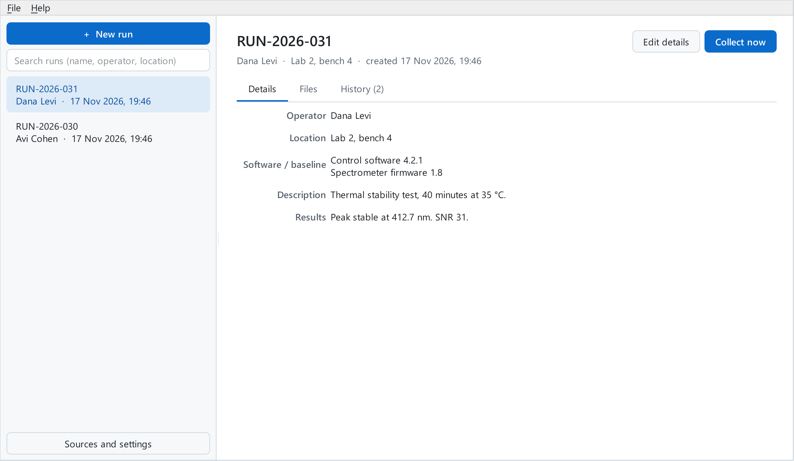

# Lab Collector

A Windows desktop app that collects the output files of a lab run from several source folders,
using configurable rules, and copies them into one organized folder per run. It keeps each run's
details and the history of every collection, checks every copied file, writes a clear
success / partial / failed report, and sends a UDP message to a remote computer.



- **Rules** per source folder: file-name prefix, extensions, newest N files, maximum age, and
  how many files are expected.
- **Verification** of every copy: size, SHA-256 checksum, empty files, and content checks
  (e.g. .json, .xlsx/.docx/.zip, .pdf, .png, .jpg).
- **Report** of each collection: missing files, files that couldn't be copied, corrupt files,
  each with the reason.
- **Settings** in the app or in `data\config.yaml`, which you can also edit by hand.

Documentation: [User guide](docs/USER_GUIDE.md) (also in the app: Help → User guide, F1) ·
[Architecture](docs/ARCHITECTURE.md) · [Requirements](docs/SPEC.md) · [AI usage](AI_USAGE.md) ·
[Changelog](CHANGELOG.md)

## Built with

| Tool | Used for |
|---|---|
| Python 3.12 | The app |
| PySide6 (Qt) | The user interface |
| SQLite | Runs and collection history (built into Python) |
| PyYAML + pydantic | The config file and its validation |
| pytest, ruff | Tests, linting and formatting |
| PyInstaller | The Windows exe |
| Git, VS Code | Version control and editing |
| ChatGPT, Claude, Claude Code | AI assistance (see [AI usage](AI_USAGE.md)) |

## Requirements

- Windows 10 or 11
- Python **3.12 or newer** to run from source (not needed for the built exe)

## Install and run from source

```
py -3.12 -m venv .venv
.venv\Scripts\python -m pip install -r requirements.txt
.venv\Scripts\python -m labcollector
```

`py -3.12` picks Python 3.12 if several versions are installed (a newer one, e.g. `py -3.13`,
works too). On the first start the app creates `data\config.yaml` (default settings, no sources
yet), `data\labcollector.db` and `data\logs\app.log`.

## Try it in 5 minutes

1. **Create demo data**: three demo source folders and a matching `data\config.yaml`. Your
   current `data\config.yaml`, if any, is kept as `config.yaml.bak`; running the tool again
   replaces that backup.
   ```
   .venv\Scripts\python tools\make_demo_data.py
   ```
2. **Start the app**, click **+ New run**, enter a name and click **Save**.
3. Click **Collect now**. The preview shows what each rule found; the Spectrometer rule is
   marked ⚠ because its file is missing. Click **Start collection**.
   - Expected: **Partial**: the report says "Collection partly succeeded". `results.json` is
     reported as corrupt (it is cut off) and the spectrum file as missing.
   - Collect within 30 minutes of step 1. The demo files are dated relative to when they were
     created, and one rule only takes files from the last 2 hours. Later, just run step 1 again.
4. Fix the demo data and collect again:
   ```
   .venv\Scripts\python tools\make_demo_data.py --fixed
   ```
   - Expected: **Success** ("Collection succeeded"). Both collections are listed in the
     **History** tab, each in its own folder under `demo\collected\<run name>\`.
5. Look at the **Files** tab: double-click a file to open it, right-click for **Show in folder**.

### Optional checks

**UDP message.** In a second terminal, start the listener, then collect again (the demo config
sends to `127.0.0.1:5005`). Settings → **Send test message** also sends one.
```
.venv\Scripts\python tools\udp_listener.py
```
To use a second computer, copy `tools\udp_listener.py` to it (it needs only Python), run it,
allow Python through the Windows firewall when asked, and set its IP address in Settings.

**A file that can't be copied.** Lock a file, collect, and it is reported as "Couldn't copy":
```
.venv\Scripts\python tools\lock_file.py demo\sources\ControlPC\syslog_2.txt
```

**A broken config file.** Open `data\config.yaml` in Notepad, change `newest: 3` to
`newest: zero` and save. Then click **Collect now** (or open Settings): the app explains which
setting is wrong and offers **Open config.yaml** or **Reset to default**. Afterwards, run
`tools\make_demo_data.py` again to restore the demo settings (Reset to default has no
sources).

**A network folder as the output.** Share a folder (Properties → Sharing → Advanced Sharing,
with Change permission), and set Settings → Output to `\\localhost\<share name>` or
`\\<other computer>\<share name>`.

## Build the exe

```
.venv\Scripts\python tools\build.py
```

This creates `dist\LabCollector\`. Copy the whole folder to any Windows computer, into a folder
you can write to (e.g. `C:\LabCollector` or your user folder, not Program Files), and run
`LabCollector.exe`; Python is not needed. The app keeps its data in a `data` folder next to the
exe.

**Rebuilding replaces `dist\LabCollector\` completely**, including its `data` folder, so copy the
build elsewhere before using it. For example, to copy it to your user folder, give it the demo
settings, and start it:
```
Copy-Item -Recurse dist\LabCollector $HOME\LabCollector
.venv\Scripts\python tools\make_demo_data.py --config "$HOME\LabCollector\data\config.yaml"
& "$HOME\LabCollector\LabCollector.exe"
```
Windows may warn that the app is from an unknown publisher (it isn't code-signed): click
**More info → Run anyway**.

## Development

```
.venv\Scripts\python -m pytest            # all tests (the UI tests run without a window)
.venv\Scripts\python -m ruff format .     # format
.venv\Scripts\python -m ruff check .      # lint
```

| Folder | Contents |
|---|---|
| `labcollector\` | The app: `ui\`, `services\`, `core\`, `infra\` (see [Architecture](docs/ARCHITECTURE.md)) |
| `tests\` | pytest tests, grouped by module; they use temporary folders only |
| `tools\` | Demo data, UDP listener, file locker, exe build |
| `docs\` | Requirements, architecture, user guide |
