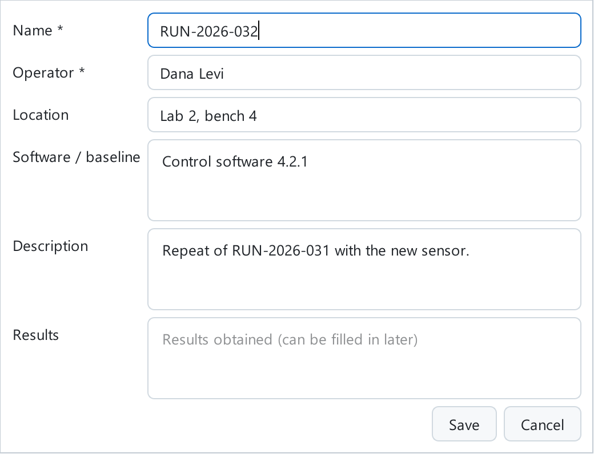
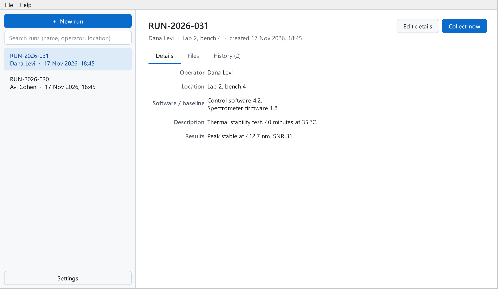
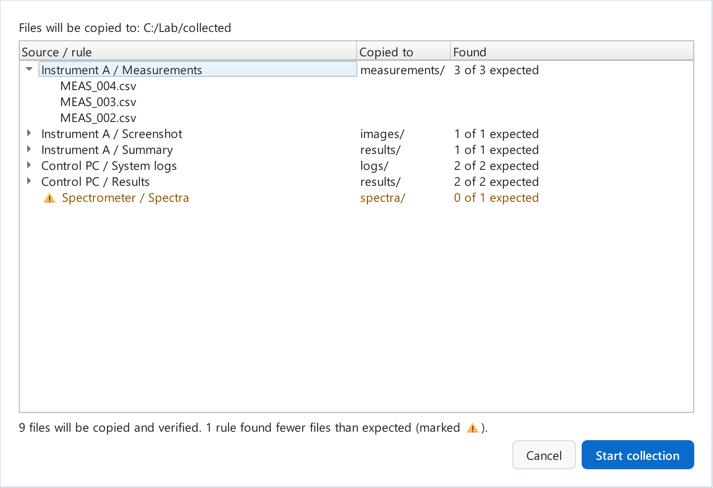
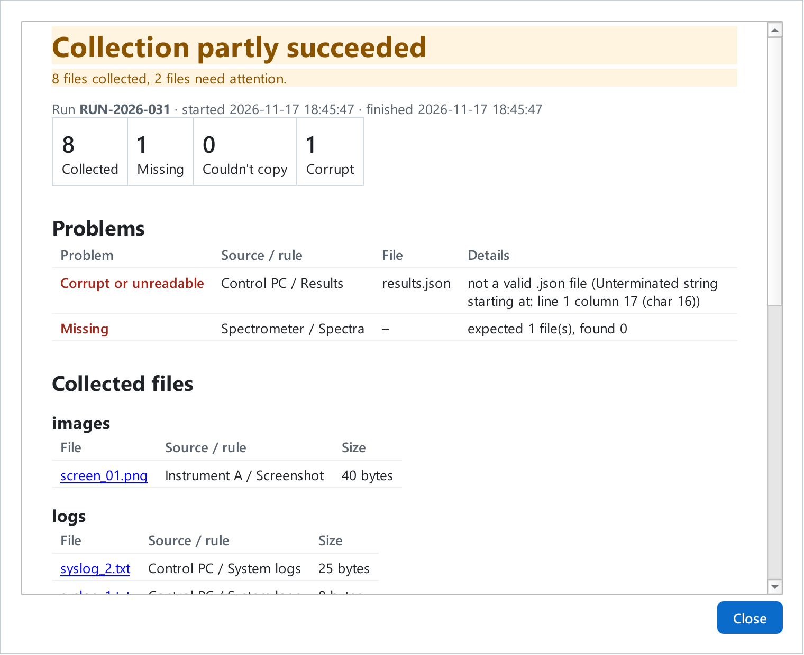
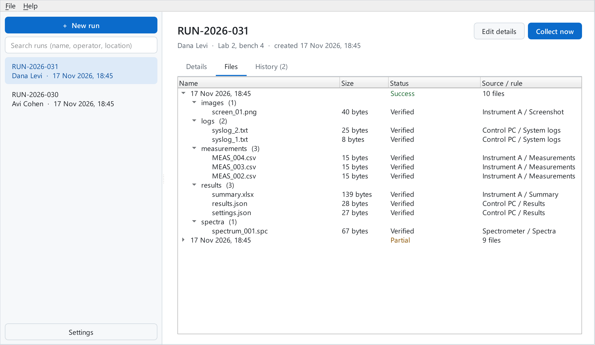
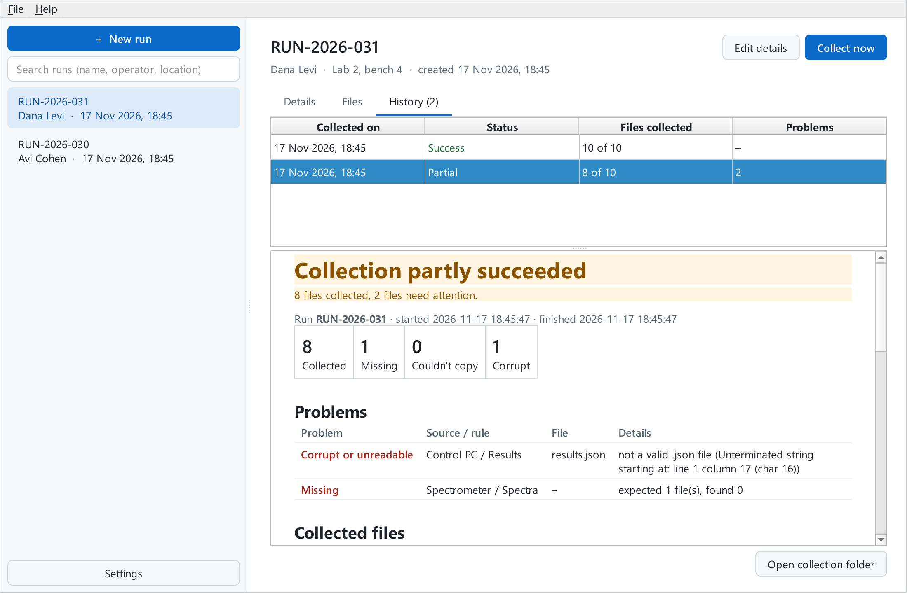
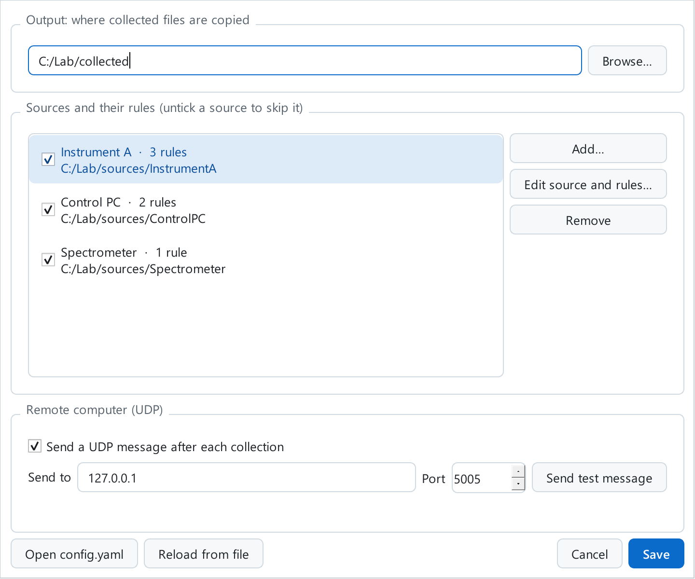
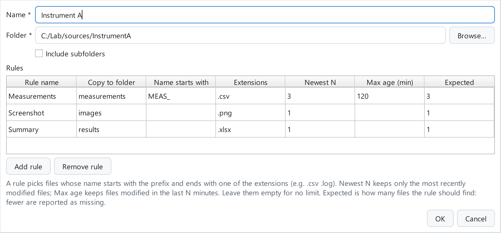

# Lab Collector user guide

Lab Collector gathers the files a lab run produced from the instrument folders, copies them into
one organized folder per run, checks every copy, and tells you clearly what was collected and
what is missing or broken. It also remembers each run's details and every collection.

**In short:** create a run → click **Collect now** → read the report.

---

## 1. Create a run

A *run* is one experiment or test. Click **+ New run** (or press Ctrl+N).

| Field | What to enter |
|---|---|
| **Name** \* | A unique name, e.g. `RUN-2026-031`. It names the run's folder, so it can't be changed later. |
| **Operator** \* | Who performed the run. Your Windows user name is filled in; change it if someone else ran it. |
| **Location** | The lab or site. |
| **Software / baseline** | The software versions used, or the baseline name. |
| **Description** | What was done and what happened. |
| **Results** | The outcome. You can leave it empty and fill it in later with **Edit details**. |

If something is wrong (an empty name, a name already used, characters Windows doesn't allow in
folder names), the form says what to fix and stays open.

## 2. The main window

- **Left:** your runs, newest first. Type in the search box to filter by name, operator or
  location.
- **Right:** the selected run, with three tabs:
  - **Details**: the run's information. **Edit details** changes it.
  - **Files**: every collected file.
  - **History**: every collection of this run, with its report.

## 3. Collect the files

Select a run and click **Collect now**. Lab Collector first shows what it *will* collect, before
copying anything:

- Each line is one rule of one source folder, with the files it found (click ▸ to see them)
  and the folder they will be copied to.
- A line marked **⚠** in orange found fewer files than expected; those files will be reported
  as missing. You can fix the files or the rule now, or collect anyway.

Click **Start collection**. A progress bar shows each file as it is copied and checked.
**Cancel** stops after the current file; whatever was already copied is kept and reported.

When it finishes, the report appears:

### What the result means

| Result | The report says | Meaning |
|---|---|---|
| **Success** (green) | Collection succeeded | Every expected file was copied and verified. |
| **Partial** (orange) | Collection partly succeeded | Some files were collected, but at least one is missing, couldn't be copied, or is corrupt. |
| **Failed** (red) | Collection failed | Nothing was collected, or a serious error stopped it (e.g. the output folder can't be reached). |

Problems are listed first, each with the reason:

| Problem | Meaning | What to do |
|---|---|---|
| **Missing** | A rule found fewer files than expected, or the source folder couldn't be reached. | Check that the instrument wrote its files and the folder is reachable, then collect again. |
| **Couldn't copy** | The file exists but couldn't be read or written, usually because another program has it open. | Close the program using the file, then collect again. |
| **Corrupt or unreadable** | The file was copied, but it's empty, the copy differs from the original, or its content is broken (e.g. a .json or .xlsx file that can't be read). | Check the original file on the instrument. |

**Every collection is kept.** Collecting again never overwrites an earlier collection: each
one gets its own folder, named by date and time. If the remote computer is set up (see
Settings), a short message with the result is sent to it.

## 4. Files tab

Collections are listed newest first, each with its files grouped by category folder.

- **Double-click** a file to open it with its usual program (e.g. Excel for .xlsx).
- **Right-click** a file or folder for **Open**, **Show in folder** and **Copy path**.
- A corrupt file shows its status in red; point at it to see why. Missing files and files that
  couldn't be copied aren't here, because there is no copy; they are listed in the report.

## 5. History tab

One row per collection: when, the result, how many of the expected files were collected, and
how many problems. Click a row to see its full report below. **Open collection folder** opens
it in File Explorer. Click a file name in the report to open the file.

## 6. Settings

Open **Settings** (bottom left, or File → Settings, Ctrl+,).

- **Output**: where collected files are copied. It can be a local folder or a shared network
  folder, e.g. `\\server\LabRuns`.
- **Sources and their rules**: the folders to collect from. **Untick** a source to skip it
  without deleting it. **Add…** creates a source; **Edit source and rules…** (or double-click)
  changes one.
- **Remote computer (UDP)**: the IP address (or computer name) and port of the computer that is
  told about each collection. **Send test message** checks the address right away.

Click **Save** to apply. If a value is wrong, Settings says which one and stays open.

### Sources and rules

A source is one folder, for example where an instrument saves its output. Tick **Include
subfolders** to also look inside its subfolders. Each **rule** picks some of the folder's files:

| Column | Meaning | Example |
|---|---|---|
| **Rule name** | A name for the rule, shown in the preview and the report. | `Measurements` |
| **Copy to folder** | The category folder the files are copied into. | `measurements` |
| **Name starts with** | Only files whose name starts with this text (any case). Empty = any name. | `MEAS_` |
| **Extensions** | Only these file types, separated by spaces (e.g. `.csv .log`). Empty = any type. | `.csv` |
| **Newest N** | Keep only the N most recently modified files. Empty = all. | `3` |
| **Max age (min)** | Only files modified in the last N minutes. Empty = any age. | `120` |
| **Expected** | How many files the rule should find; fewer are reported as missing. Empty = 1; 0 = none required. Can't be more than Newest N. | `3` |

The example row above means: *from this folder, take the 3 newest `MEAS_*.csv` files modified
in the last 2 hours, copy them to `measurements`, and report a problem if there are fewer
than 3.* Temporary files such as Excel's `~$` lock files are always skipped.

### Editing config.yaml directly

All settings are stored in `data\config.yaml` next to the app, a plain text file you can also
edit in Notepad (**Open config.yaml** in Settings opens it). The app reads it again before every
collection, so changes take effect without restarting.

- If the file has a mistake, the app says which line or setting is wrong and offers
  **Open config.yaml** or **Reset to default** (the old file is kept as `config.yaml.bak`).
- If the file was changed while Settings was open, **Save** asks before replacing those
  changes. **Reload from file** shows the file's current content.

## 7. Where things are stored

| What | Where |
|---|---|
| Collected files | `<output folder>\<run name>\<date_time>\<category>\` |
| Report of each collection | `report.html` (open in a browser) and `report.json`, in the collection's folder |
| Run details | `run.json` in the run's folder, and in the app's database |
| Settings | `data\config.yaml` next to the app |
| Runs and history | `data\labcollector.db` next to the app |
| Log (for support) | `data\logs\app.log` next to the app |

## 8. Troubleshooting

| Problem | Solution |
|---|---|
| A source shows "Source folder not found or not reachable" | Check the path in Settings, and that the network share or instrument PC is on. |
| Everything is reported missing | Check the rules: a prefix or extension typo, or **Max age** too small. The preview shows what each rule finds. |
| The remote computer gets no message | Check the IP and port with **Send test message**. On the receiving computer, allow the listener through the Windows firewall. UDP has no reply, so "sent" doesn't prove it arrived. |
| "Unexpected error" | The details are in `data\logs\app.log`; send it to support. |
